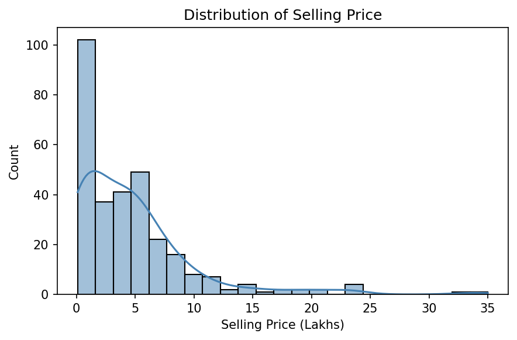
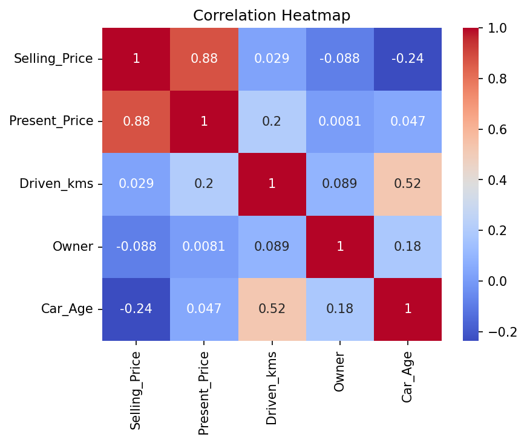
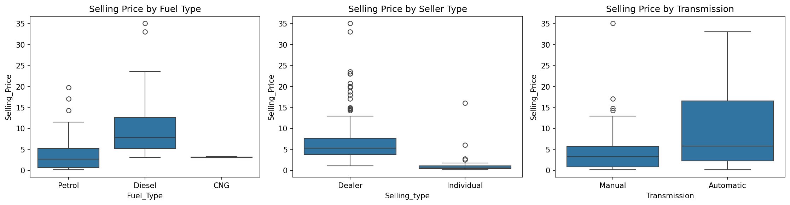
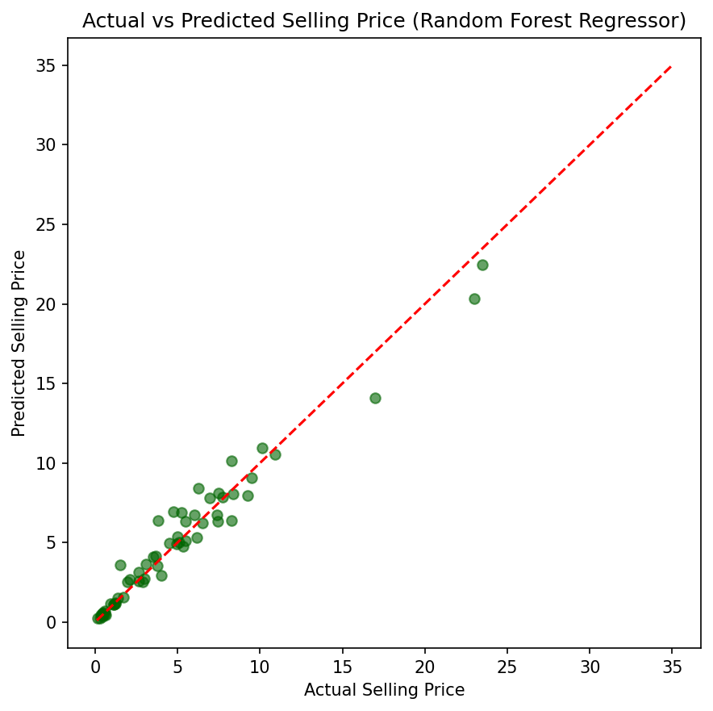
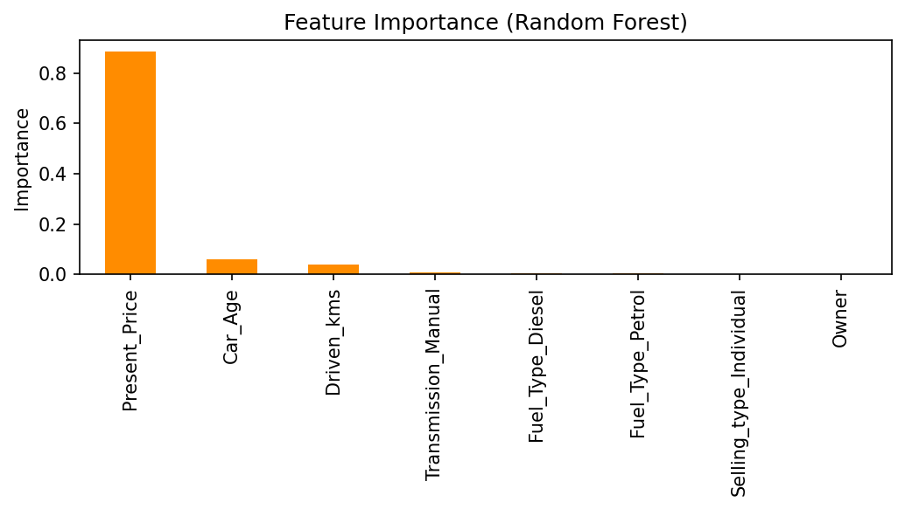

# 🚗 Car Price Prediction with Machine Learning

A machine learning project that predicts the selling price of used cars based on features such as present price, car age, kilometers driven, fuel type, seller type, transmission, and ownership history.

---

##  Overview

Pricing a used car fairly depends on many interacting factors — how new it is, how much it originally cost, how far it's been driven, and how it's being sold. This project builds a regression pipeline that learns these relationships from historical sales data, compares a linear model against an ensemble model, and identifies which features matter most when predicting a car's resale value.

##  Dataset

| Feature | Description |
|---|---|
| `Car_Name` | Name/model of the car *(dropped — too many unique values)* |
| `Year` | Year of manufacture *(converted to `Car_Age`)* |
| `Selling_Price` | Price the car was sold for, in Lakhs — **target variable** |
| `Present_Price` | Current ex-showroom price of the car, in Lakhs |
| `Driven_kms` | Total kilometers driven |
| `Fuel_Type` | Petrol / Diesel / CNG |
| `Selling_type` | Dealer / Individual |
| `Transmission` | Manual / Automatic |
| `Owner` | Number of previous owners |

- Source: `car_data.csv`
- Engineered feature: `Car_Age` = 2020 − `Year`

##  Tech Stack

- **Python 3**
- **Pandas**
- **NumPy**
- **Matplotlib**
- **Seaborn**
- **Scikit-learn**

##  Project Workflow

1. Data Loading & Inspection
2. Feature Engineering
3. Exploratory Data Analysis (EDA)
4. Data Preprocessing
5. Model Training
6. Model Evaluation
7. Performance Visualization
8. Feature Importance Analysis

##  Results

### Model Comparison

| Model | Performance | Notes |
|---|---|---|
| Linear Regression | Strong baseline | Highly interpretable |
| **Random Forest Regressor** | **Best R², Lowest Error** | Captures non-linear pricing patterns |

The Random Forest Regressor achieved the best overall performance by providing more accurate predictions than the Linear Regression model.

### Selling Price Distribution

Most vehicles are priced below 10 Lakhs, with a right-skewed distribution and a limited number of higher-priced vehicles.



### Correlation Heatmap

`Present_Price` shows the strongest positive correlation with the target variable, while `Car_Age` has a moderate negative correlation with selling price.



### Selling Price by Category

Vehicle prices vary according to fuel type, seller type, and transmission, providing useful insights into market trends.



### Actual vs Predicted Selling Price

The Random Forest model demonstrates strong agreement between predicted and actual selling prices across most observations.



### Feature Importance

Feature importance analysis indicates that `Present_Price` contributes the most to prediction accuracy, followed by `Car_Age` and `Driven_kms`.



##  How to Run

1. Clone the repository

```bash
git clone https://github.com/nada-etman/CodeAlpha_Car_Price_Prediction.git
cd CodeAlpha_Car_Price_Prediction
```

2. Install the required packages

```bash
pip install pandas numpy matplotlib seaborn scikit-learn
```

3. Run the project

```bash
python car_price_prediction.py
```

The script trains the models, evaluates their performance, and generates all visualizations automatically.

##  Project Structure

```
Car_Price_Prediction/
│
├── car_data.csv
├── car_price_prediction.py
├── car_price_distribution.png
├── car_correlation_heatmap.png
├── car_price_by_category.png
├── car_actual_vs_predicted.png
├── car_feature_importance.png
└── README.md
```

##  Key Takeaways

- Present Price is the strongest predictor of resale value.
- Older vehicles generally have lower selling prices.
- Higher mileage has a negative impact on resale value.
- Random Forest outperforms Linear Regression for this prediction task.
- Machine learning provides an effective approach for estimating used car prices.

---

